<div align="center">

# 🌐 Federated vs. Centralized Learning on CIFAR-10

### Security, Privacy and Explainability in Machine Learning · Assignment 2

*TU Wien · Summer Semester 2024 · Group 16*

[](https://www.python.org/)
[](https://www.tensorflow.org/federated)
[](alternative_architectures)
[](code)
[](https://wandb.ai/)
[](final_report.pdf)

**Centralized: 69% accuracy (epoch 3) · Federated: 65% accuracy (10 rounds)**

[Overview](#-overview) •
[Model](#-cnn-model) •
[Architectures](#%EF%B8%8F-architectures) •
[Results](#-results) •
[Conclusions](#-conclusions) •
[Setup](#-setup) •
[Authors](#-authors)

<br/>

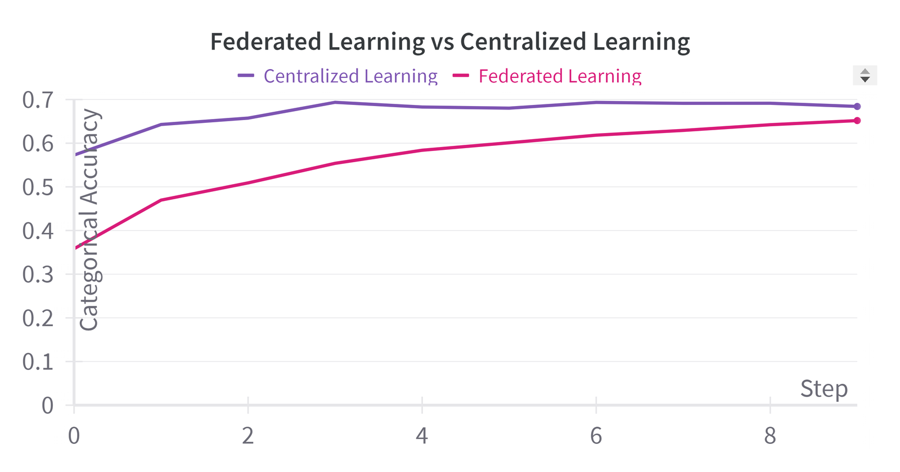

</div>

---

## 🎯 Overview

We compare the predictive effectiveness of **federated learning** with **centralized learning** for image classification on **CIFAR-10**.

Federated learning trains one central model from data that stays distributed across many nodes. Only model updates are shared, never the raw data, which helps keep the data private and secure.

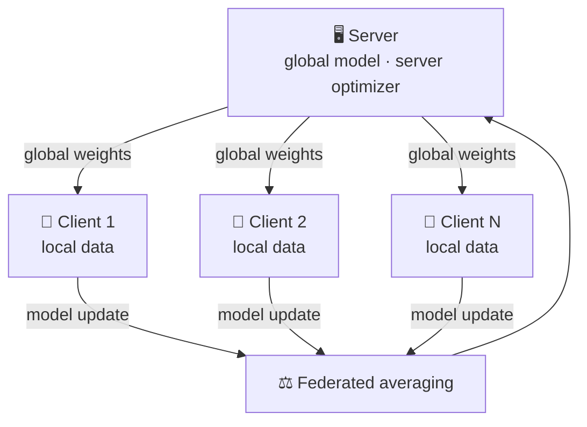

**Experiments**

| # | Experiment | What we vary |
|:--:|:--|:--|
| 1 | Client & server optimizers | SGD / Adam combinations on both sides |
| 2 | Federated hyperparameters | Batch size and number of clients |
| 3 | Differential privacy | Noise level: 0, 0.1, 0.5 |
| 4 | Model & update compression | With vs. without compression |
| 5 | Federated vs. centralized | Best setup of each |

---

## 🧠 CNN Model

A small but efficient CNN. It converges quickly on limited hardware without a GPU, so we could run many experiments in a reasonable time.

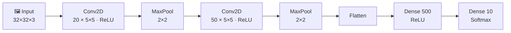

---

## 🏗️ Architectures

| Architecture | Status | Notes |
|:--|:--:|:--|
| **PySyft 0.2.9** (PyTorch 1.4.0) | ✅ Works | Virtual Workers on a single host. Likely no privacy techniques such as differential privacy. |
| **PySyft 0.8** | ❌ Failed | Federated learning is no longer supported out of the box. Examples only cover two parties. |
| **TensorFlow Federated** | ⭐ Final | Good documentation, differential privacy, and model & update compression. |

The PySyft experiments are in [`alternative_architectures/`](alternative_architectures), which has its own README.

**How the TFF pipeline works**

1. Load CIFAR-10 with `tf.keras.datasets`, normalize the pixel values and one-hot encode the labels.
2. Split the data into a federated dataset (tensor slices by number of clients and batch size).
3. Build the algorithm with `build_weighted_fed_avg` / `build_unweighted_fed_avg`, choosing client and server optimizers.
4. Run rounds with `IterativeProcess.next`.
5. After each round, copy the weights into a centralized clone of the model and evaluate it on the holdout test set. This makes the comparison with centralized learning fair.

---

## 📊 Results

> All TFF results are validation accuracy on a holdout test set, measured after each round of federated learning.

### PySyft 0.2.9: number of workers

<p align="center">
  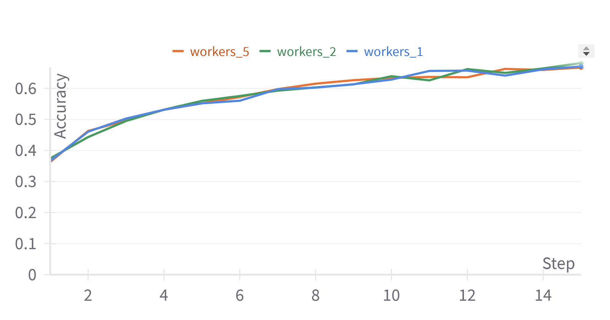
  &nbsp;
  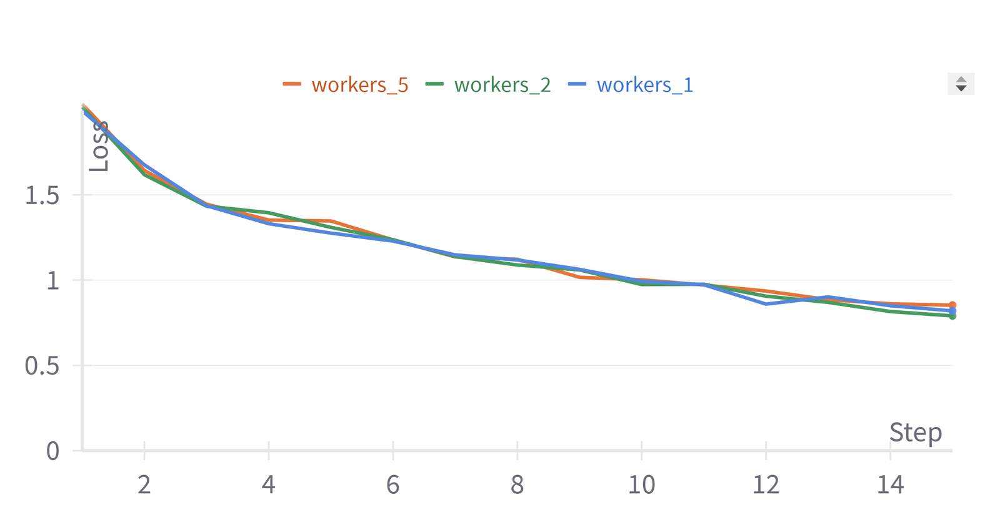
</p>

The CNN learns at the same pace whatever the number of workers, and accuracy doesn't change. With no privacy techniques and equally split data, this doesn't reflect real conditions.

### TFF: optimizers

<div align="center">
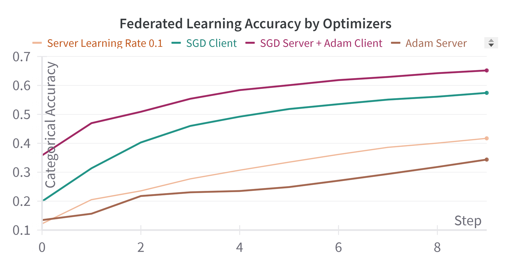
</div>

**SGD on the server + Adam on the clients** gave the best accuracy, so we used it as the baseline for the other experiments.

### TFF: batch size and number of clients

<p align="center">
  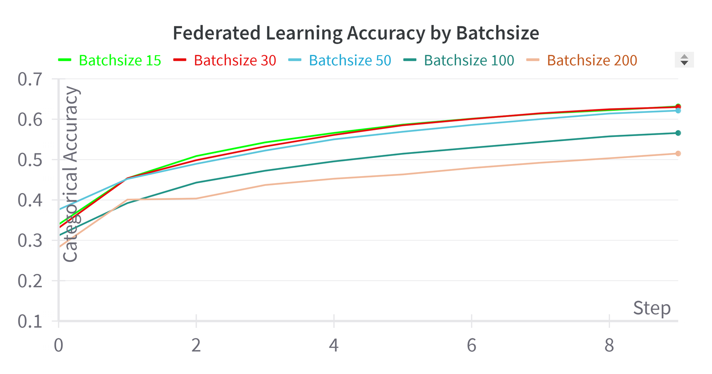
  &nbsp;
  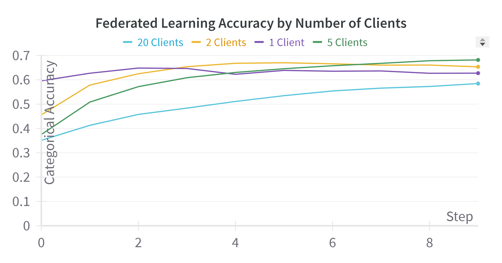
</p>

- **Batch size:** 15–30 worked best. Above 50, results got worse.
- **Clients:** with more clients, accuracy grows more slowly. **5 clients** gave the best final result.

### TFF: compression and differential privacy

<p align="center">
  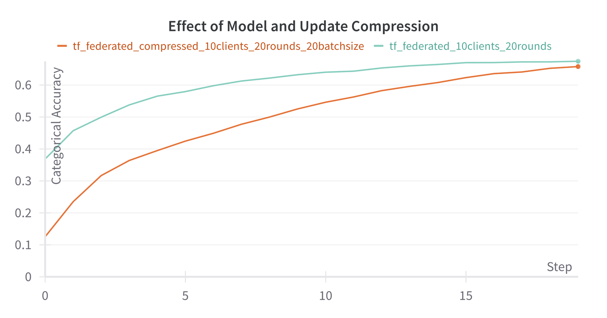
  &nbsp;
  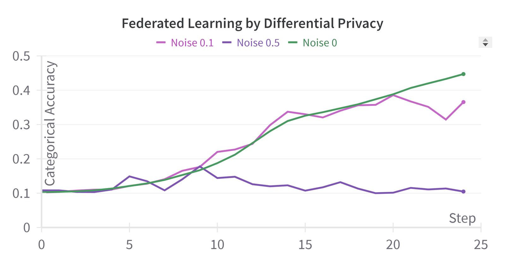
</p>

- **Compression** slows the early rounds, but both models converge to a similar accuracy after 20 rounds.
- **Differential privacy** trades accuracy for privacy. Noise of 0.1 lowered accuracy from **45% to 38%**, and at 0.5 the model barely learns.

### Federated vs. centralized

<div align="center">

| Setup | Best accuracy | Reached after |
|:--|:--:|:--:|
| Centralized learning | **69%** | 3 epochs |
| Federated learning | **65%** | 10 rounds |

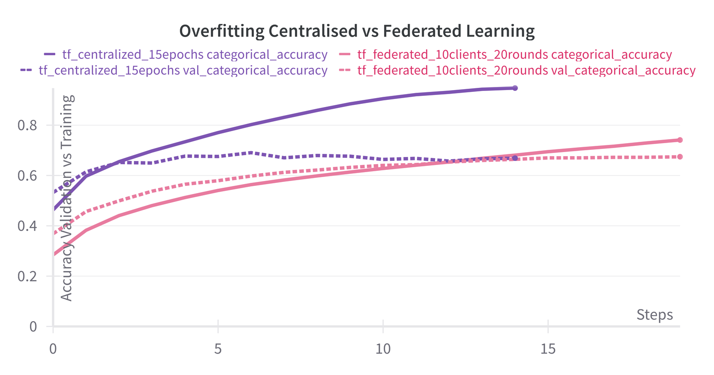
<br/><sub><i>Training (solid) vs. validation (dashed) accuracy. Centralized learning overfits much sooner than federated learning.</i></sub>

</div>

---

## 💡 Conclusions

- Federated learning reaches **slightly lower accuracy** than centralized learning and **needs more training rounds**.
- In return it **keeps data private** and can learn from much larger, distributed datasets.
- Tuning **both client and server optimizers** helps the model converge faster.
- More clients means more rounds are needed, because the data is spread across clients.
- Differential privacy is a clear **privacy–accuracy trade-off**: more noise means lower accuracy.
- TensorFlow Federated was by far the most usable library. PySyft's federated support is limited until version 0.9.

📄 The full analysis is in the [**final report**](final_report.pdf).

---

## 🚀 Setup

**Requirements:** Python 3.11

```bash
git clone https://github.com/wojo501/speml24_2.git
cd speml24_2

python3.11 -m venv venv
source venv/bin/activate        # Windows: venv\Scripts\activate

pip install -r requirements.txt
```

Then open the **centralized** or **federated** CIFAR-10 notebook in [`code/`](code) and run it.

- **Hyperparameters** are in the second cell of each notebook.
- **Other experiment settings** are marked with `EXPERIMENT` comments in the code.
- **Weights & Biases** logging is available but turned off by default.

<details>
<summary><b>🛠️ Troubleshooting (click to expand)</b></summary>

<br/>

- **VS Code kernel error caused by `typing_extensions`:** upgrade the package:
  ```bash
  pip install --upgrade typing_extensions
  ```
- **Serialization error with large client datasets:** TensorFlow Federated has a default serialization limit of 100 MB. Raise it in the TFF library source if your client datasets are larger.

</details>

---

## 📁 Project Structure

```
speml24_2/
├── alternative_architectures/   # PySyft experiments (own README)
├── assets/                      # Images used in this README
├── code/                        # Centralized & federated CIFAR-10 notebooks (TFF)
├── final_report.pdf             # Full project report
└── requirements.txt
```

---

## 👥 Authors

<div align="center">

<table>
<tr>
<td align="center">
<a href="https://github.com/wojo501"><br/><sub><b>Wojciech Michaluk</b></sub></a>
</td>
<td align="center">
<sub><b>Stephan Klein</b></sub>
</td>
</tr>
</table>

<sub>TU Wien · Security, Privacy and Explainability in Machine Learning · SS 2024</sub>

</div>

---

## 📚 References

1. [Federated Learning example with syft version 0.7 · Issue #7384 · OpenMined/PySyft](https://github.com/OpenMined/PySyft/issues/7384)
2. Krizhevsky, A., Nair, V., Hinton, G.: [CIFAR-10](http://www.cs.toronto.edu/~kriz/cifar.html)
3. ur Rehman, M.H., Gaber, M.M. (eds.): *Federated Learning Systems: Towards Next-Generation AI*. Springer, 2021. [doi:10.1007/978-3-030-70604-3](https://doi.org/10.1007/978-3-030-70604-3)
